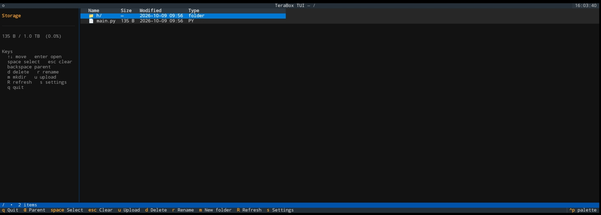
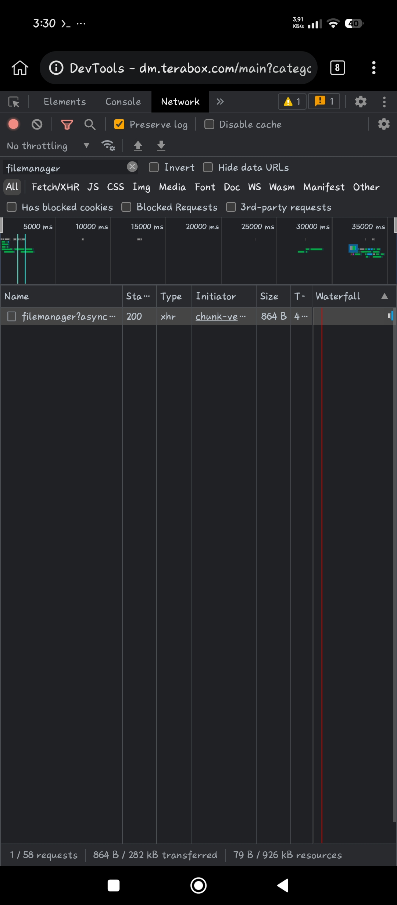
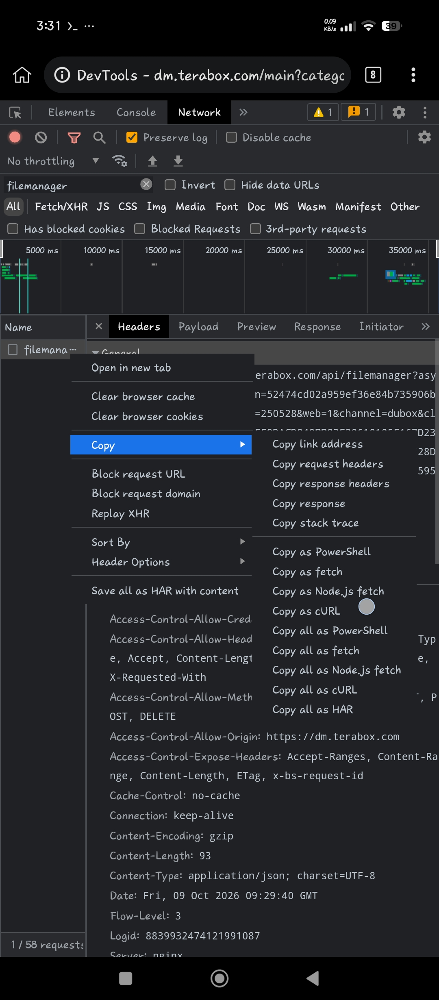

# terabox-tui



Terminal file manager for TeraBox, built on the `dm.terabox.com` web API.

- Browse remote folders (name / size / modified, click headers to sort)
- Download files with progress (`.part` then rename)
- Upload files or whole folders (16 MiB chunks, resumable via `precreate`)
- Delete (with confirmation + task polling), rename, create folders
- Storage quota bar, multi-select with `space`, refresh

## Install

```bash
pip install -r requirements.txt   # textual, requests
```

## Run

```bash
python3 -m terabox_tui            # or: python3 main.py
python3 -m terabox_tui --start /some/folder
```

## Credentials

On first run a settings dialog opens. Provide credentials either way:

1. **Paste a curl command** (recommended) — see
   [Getting the curl command](#getting-the-curl-command) below. *Parse Creds*
   fills `Cookie`, `jsToken` and `bdstoken` automatically.
2. **Fill the fields** manually — all three are needed: `Cookie` and `jsToken`
   are required to run at all, `bdstoken` for delete/rename/mkdir/upload.

They are stored in `~/.config/terabox-tui/config.json` (mode `600`) — never
commit this file. Reopen the dialog any time with `s`. Rotate the `ndus`
cookie if you pasted it somewhere you shouldn't.

### Getting the curl command

1. Open <https://dm.terabox.com/main> in your browser and log in.
2. Upload any random file.
3. Open DevTools (`F12` / `Ctrl+Shift+I` / right-click → *Inspect*) and go
   to the **Network** tab.
4. Delete the file you just uploaded.
5. In DevTools, type `filemanager` into the filter input — the delete
   request appears:

   

6. Hold it and click **Copy as cURL**:

   

7. Paste it into the curl field in the app's settings dialog, press
   **Parse Creds**, then **Save**.

## Keys

| Key | Action |
| --- | --- |
| `↑` `↓` `pgup` `pgdn` | move cursor |
| `enter` | open folder / download file |
| `backspace` / `h` | parent directory |
| `space` | toggle select (row gets highlighted) |
| `esc` | clear selection |
| `d` | delete (confirm — `←` `→` switch Yes/No, `enter` accepts) |
| `r` | rename |
| `m` | new folder |
| `u` | upload local path |
| `R` | refresh |
| `s` | settings |
| `q` | quit |
